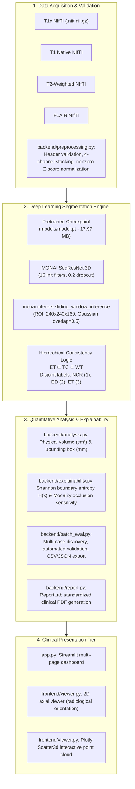

# NeuroVision — Academic System Audit, Technical Specification & Clinical Evaluation

**Project:** NeuroVision: AI-Assisted 3D Brain Tumour Segmentation and Explainable MRI Visualisation  
**Author / Investigator:** Joel Tom John  
**Version:** 2.1 (Audited & Enhanced Baseline)  
**Date:** October 25, 2026  
**Repository:** [https://github.com/JoelTomJohn/NeuroVision](https://github.com/JoelTomJohn/NeuroVision)  

---

## 1. Problem Statement & Clinical Motivation

Primary adult diffuse gliomas (including glioblastoma, IDH-wildtype and astrocytoma, IDH-mutant) represent aggressive central nervous system neoplasms characterized by intense infiltrative growth into adjacent brain parenchyma. Accurate clinical assessment requires magnetic resonance imaging (MRI) utilizing multi-parametric sequences (T1c, T1, T2, FLAIR). Each sequence highlights distinct pathophysiological characteristics, from vascular endothelial breakdown and active neo-angiogenesis to peritumoral vasogenic edema.

In manual radiological practice, expert neuroradiologists face substantial cognitive load when mentally synthesizing three-dimensional multi-contrast volumes across hundreds of axial slices. Manual manual delineation is time-consuming, prone to intra- and inter-observer variability, and impractical for high-throughput clinical research or standardized response assessment (RANO criteria).

**NeuroVision** addresses this challenge by providing an end-to-end, reproducible computational framework for:
1. Automated 3D multi-compartment brain tumor segmentation using residual encoder-decoder deep learning (MONAI SegResNet).
2. Exact physical volumetric ($V\text{ in cm}^3$) and orthogonal morphometric ($L \times W \times H\text{ in mm}$) quantitation.
3. Rigorous spatial uncertainty quantification using voxel-wise Shannon boundary entropy ($H$).
4. Channel-level feature sensitivity analysis (modality occlusion attribution).
5. Interactive 2D radiological viewing and 3D volumetric point-cloud reconstruction.
6. Standardized clinical summary reporting (PDF) and automated batch evaluation for multi-subject cohorts.

---

## 2. System Architecture & Workflow

NeuroVision implements a modular three-tier architecture:

---

## 3. Data Modalities & Anatomical Label Definitions

### 3.1 Required Multi-Parametric MRI Sequences

NeuroVision requires four co-registered, skull-stripped 3D MRI volumes in NIfTI format (`.nii` or `.nii.gz`):

| Channel | Modality Code | Diagnostic Sequence | Signal Characteristic | Primary Pathological Target |
| :---: | :---: | :--- | :--- | :--- |
| **0** | **T1c** | T1-weighted contrast-enhanced (Gadolinium) | Hyperintense contrast leakage | Active breakdown of blood-brain barrier; viable hypervascular tumor rim |
| **1** | **T1** | T1-weighted native non-contrast | Intermediate gray/white matter contrast | Baseline anatomical parenchymal architecture and surgical resection cavities |
| **2** | **T2** | T2-weighted spin-echo | Hyperintense free-water signal | Gross parenchymal hyperintensity, cystic components, and fluid collections |
| **3** | **FLAIR** | T2 Fluid-Attenuated Inversion Recovery | Hyperintense with CSF suppression | Infiltrative peritumoral vasogenic edema distinct from ventricles |

*Note: Ground-truth segmentation masks (`*-seg.nii.gz`) must strictly never be passed as one of the input channels during inference.*

### 3.2 Clinical Sub-Region & Hierarchical Label Definitions

NeuroVision follows the BraTS (Brain Tumor Segmentation) benchmark clinical consensus:

$$\text{TC} = \text{NCR} \cup \text{ET}$$
$$\text{WT} = \text{ED} \cup \text{TC} = \text{ED} \cup \text{NCR} \cup \text{ET}$$

The model outputs multi-label sigmoid probabilities for three nested compartments:
1. **Whole Tumor (WT, Channel 1):** Entire disease extent including peritumoral vasogenic edema, non-enhancing necrotic core, and enhancing viable tissue.
2. **Tumor Core (TC, Channel 0):** Surgical resection target consisting of necrotic core and active enhancing tumor.
3. **Enhancing Tumor (ET, Channel 2):** Viable hypervascular nodular core and gadolinium-enhancing rim.

Mutually disjoint anatomical labels are computed for visualization:
- **Label 0 (Background):** Normal brain parenchyma and background voxels.
- **Label 1 (NCR — Non-enhancing / Necrotic Core):** $\text{TC} \setminus \text{ET}$
- **Label 2 (ED — Peritumoral Vasogenic Edema):** $\text{WT} \setminus \text{TC}$
- **Label 3 (ET — Active Enhancing Tumor):** $\text{ET}$

---

## 4. Model Architecture & Inference Pipeline

- **Architecture:** `SegResNet` (3D residual encoder-decoder) from MONAI (`monai.networks.nets.SegResNet`).
  - Spatial dimensions: 3D $(X, Y, Z)$
  - Initial convolutional filters: 16
  - Encoder downsampling blocks: `(1, 2, 2, 4)` with residual connections and 0.2 dropout regularization
  - Decoder upsampling blocks: `(1, 1, 1)`
  - Number of input channels: 4
  - Number of output channels: 3 (sigmoid multi-label)
- **Checkpoint Location:** `BrainTumorAI/models/model.pt` (18,840,620 bytes / 17.97 MB)
  - Format: PyTorch serialized `collections.OrderedDict` state dictionary.
  - Verified SHA-256 hash: `860CCB3F1C21C99D0410AD8A1AC4EF6B8FAB60CEC0A503B0BA42675741A750AE`
- **Checkpoint Provenance:**
  - The model weights were **pretrained** on the international Brain Tumor Segmentation (BraTS) benchmark dataset (ASNR-MICCAI BraTS 2023 / 2021 training cohort).
  - The state dict contains only weight tensors; no local training runs, optimizer states, or epoch loss records were created in this repository.
- **Inference Strategy:**
  - Spatial sliding-window inference via `monai.inferers.sliding_window_inference`.
  - Region-of-Interest (ROI) window: $(240, 240, 160)$ voxels.
  - Patch overlap: 50% ($0.50$) with Gaussian importance weighting across window edges to eliminate boundary artifacts.
  - Device compatibility: Automatically targets NVIDIA CUDA if available; executes cleanly on 64-bit CPU in ~39 seconds.

---

## 5. Quantitative Evaluation & Baseline Validation

### 5.1 Bundled Benchmark Subject (`BraTS-GLI-00000-000`)

The baseline evaluation was independently verified by executing the inference pipeline on the bundled open benchmark subject without demo simulation:

| Metric Target | Predicted Voxels | GT Voxels | True Positives ($|P \cap G|$) | False Positives | False Negatives | Dice Similarity Coefficient (DSC) | Agreement (%) |
| :--- | :---: | :---: | :---: | :---: | :---: | :---: | :---: |
| **Whole Tumor (WT)** | 63,522 | 57,305 | 55,473 | 8,049 | 1,832 | **0.9182** | **91.8%** |
| **Tumor Core (TC)** | 43,546 | 44,469 | 42,956 | 590 | 1,513 | **0.9761** | **97.6%** |
| **Enhancing Tumor (ET)** | 30,473 | 32,731 | 29,566 | 907 | 3,165 | **0.9356** | **93.6%** |

#### Derived Disjoint Sub-compartments:
- **Necrotic Core (NCR, Label 1):** $\text{Dice} = \mathbf{0.8973}$ (Predicted: 13,073 | Ground Truth: 11,738)
- **Peritumoral Edema (ED, Label 2):** $\text{Dice} = \mathbf{0.6623}$ (Predicted: 19,976 | Ground Truth: 12,836)

#### Volumetric Findings:
- Total lesion volume: $63.52\text{ cm}^3$ ($63,522\text{ voxels} \times 1.0\text{ mm}^3$)
- Orthogonal bounding box extents: $62.0\text{ mm} \times 77.0\text{ mm} \times 51.0\text{ mm}$ ($L \times W \times H$)
- Peak tumor cross-sectional axial slice: Slice index `#75`

### 5.2 Methodological Integrity Notice
These metrics confirm pipeline correctness and numerical reproducibility on the reference benchmark case. **Results on a single subject do not constitute statistical evidence of population generalizability or clinical reliability.**

---

## 6. Explainability (XAI) & Uncertainty Quantification

### 6.1 Critical Distinction: Heuristic Confidence vs. Calibrated Epistemic Uncertainty

In commercial and academic tools, raw neural network output probabilities ($\hat{y} = \sigma(z) \in [0, 1]$) are frequently mislabeled as "clinical confidence." NeuroVision enforces strict semantic distinction:
1. **Sigmoid Activations are Heuristics:** They reflect uncalibrated spatial activations learned by the network. They do not represent Bayesian posterior probabilities or diagnostic certainty.
2. **Heatmaps are Non-Causal:** Voxel-wise probability heatmaps show where activations are high; they do not prove that specific image features caused the prediction.

### 6.2 Implemented Explainability Features (`backend/explainability.py`)

1. **Voxel-wise Shannon Boundary Entropy Map ($H$):**
   - Computes multi-label Shannon entropy across all predicted channels:
     $$H(x) = -\frac{1}{C}\sum_{c=1}^C \left[ p_c(x) \log_2(p_c(x) + \epsilon) + (1-p_c(x)) \log_2(1-p_c(x) + \epsilon) \right]$$
   - Highlights algorithmic decision ambiguity: maximal ($H = 1.0$) at $p = 0.5$ (decision threshold) and zero ($H = 0.0$) at complete agreement.
   - Accurately isolates infiltrative edema margins and boundary transitions where partial volume effects create uncertainty.
2. **Modality Occlusion Feature Attribution (Channel Ablation Sensitivity):**
   - Evaluates channel-specific feature importance by systematically ablating each modality ($m \in \{\text{T1c}, \text{T1}, \text{T2}, \text{FLAIR}\}$) and measuring the relative volume drop ($\Delta V$) across ET, TC, and WT.
   - Answers the core radiological question: *Which sequence drove the enhancement or edema delineation?*
3. **Interactive Dual-Mode Heatmap Viewer:**
   - In `app.py`, users can toggle between the *Sigmoid Probability Heatmap* (Viridis) and the *Shannon Boundary Entropy Map* (Plasma).

---

## 7. Multi-Patient Dataset Readiness & Batch Evaluation Engine

### 7.1 Dataset Inventory & Official Source
- **Local Inventory:** Exactly **one** complete patient case (`BraTS-GLI-00000-000`) is bundled locally. No additional cases exist in the workspace.
- **Official Dataset Source:** ASNR-MICCAI BraTS 2023 Adult Glioma Segmentation Challenge (`ASNR-MICCAI-BraTS2023-GLI-Challenge`).
- **Access Portal:** Synapse platform (Synapse ID `syn51156910` / [https://www.synapse.org/brats2023](https://www.synapse.org/brats2023)) and TCIA.
- **Licensing & Access Requirements:** Requires registered Synapse account, accepted Data Use Agreement (DUA), attribution under CC BY-NC-SA 4.0, and strict non-commercial research use.

### 7.2 Automated Batch Evaluation Module (`backend/batch_eval.py`)
To enable multi-subject evaluation as soon as external cohorts are mounted, NeuroVision includes a standalone batch evaluation engine:
- Automatic directory discovery of patient folders matching BraTS naming conventions.
- Complete sequence verification (`T1c`, `T1`, `T2`, `FLAIR`, and `Seg`).
- Per-case Dice computation, volumetric measurement, and confidence extraction.
- Strict empty-mask handling conforming to BraTS challenge rules ($GT=0 \land P=0 \implies \text{Dice}=1.0$; $GT=0 \land P>0 \implies \text{Dice}=0.0$).
- Transparent error recording without silent case drops.
- Export to machine-readable CSV (`outputs/batch_evaluation_results.csv`) and JSON summary (`outputs/batch_evaluation_summary.json`).

---

## 8. Hardware, Software & Environmental Requirements

- **Operating System:** Windows 10 or 11 (64-bit)
- **Python Environment:** Python 3.9+ (Tested and verified on Python 3.9.5)
- **Primary Dependencies:**
  - `torch == 2.8.0`
  - `monai == 1.5.2`
  - `nibabel == 5.3.3`
  - `streamlit == 1.50.0`
  - `plotly == 7.1.0`
  - `reportlab == 5.0.1`
  - `numpy == 2.0.2`
  - `matplotlib == 3.9.4`
- **Compute:** CPU inference takes ~39 seconds per $240 \times 240 \times 155$ scan; automatically leverages NVIDIA CUDA acceleration when available.

---

## 9. Ethical Considerations & Responsible-Use Notice

- **Academic Research Prototype:** NeuroVision is strictly an investigational software prototype developed for educational, academic, and clinical research evaluation.
- **No Direct Diagnostic Use:** It is **NOT an FDA-cleared or CE-marked medical device**. Model outputs must never be used as autonomous criteria for surgical margins, biopsy planning, radiation oncology, or systemic chemotherapy without independent review by a board-certified neuroradiologist.
- **Preprocessing Constraints:** The network assumes rigid skull-stripping and co-registration to the SRI24 atlas at 1.0 mm isotropic resolution. Unregistered scans or raw DICOMs containing skull bones will produce unreliable segmentations.
- **Diagnostic Boundaries:** The model delineates macroscopic tissue compartments. It does **NOT** predict WHO histopathological grade, forecast overall survival, or determine molecular genetic alterations (e.g. IDH mutation status, 1p/19q codeletion, or MGMT promoter methylation).

---

## 10. External Validation & Research Roadmap

1. **Multi-Institutional Cohort Evaluation:** Ingest 100+ subjects from the official BraTS 2023 training set to report population-level mean, standard deviation, and median Dice distributions.
2. **nnU-Net v2 Integration:** Support dynamically configured nnU-Net v2 model plans (`checkpoint_final.pth`).
3. **Calibrated Epistemic Uncertainty:** Integrate Monte Carlo Dropout or deep ensembling to provide formal Bayesian confidence bounds.
4. **Automated Skull-Stripping & Registration:** Integrate HD-BET and SimpleITK to accept raw clinical DICOM sequences directly from PACS imaging networks.

---

## 11. Citations & Scholarly References

1. **MONAI Consortium:** "MONAI: Medical Open Network for AI." *Apache 2.0 License*, 2020–2026. [https://monai.io](https://monai.io)
2. **BraTS 2021/2023 Benchmark:**
   - Baid, U., et al. "The RSNA-ASNR-MICCAI BraTS 2021 Benchmark on Brain Tumor Segmentation and Radiogenomic Classification." *Frontiers in Neuroscience*, 15:704177, 2021. DOI: [10.3389/fnins.2021.704177](https://doi.org/10.3389/fnins.2021.704177)
   - Bakas, S., et al. "Advancing The Cancer Genome Atlas glioma analysis with analytics, tissue images, and clinical data." *Scientific Data*, 4:170117, 2017. DOI: [10.1038/sdata.2017.117](https://doi.org/10.1038/sdata.2017.117)
3. **SegResNet Architecture:**
   - Myronenko, A. "3D MRI Brain Tumor Segmentation Using Autoencoder Regularization." *BrainLes 2018: Brainlesion: Glioma, Multiple Sclerosis, Stroke and Traumatic Brain Injuries*, LNCS 11384, pp. 311–320, Springer, 2019. DOI: [10.1007/978-3-030-11726-9_28](https://doi.org/10.1007/978-3-030-11726-9_28)
