# NeuroVision — System Architecture & Technical Specification

This document details the architectural design, component interactions, data pipelines, and deep learning algorithms implemented within **NeuroVision**.

---

## 🏛️ High-Level System Architecture

NeuroVision is structured into a modular three-tier architecture: **Presentation Tier (Streamlit UI & Visualizations)**, **Application & Analytics Tier (Preprocessing, Morphology, Reporting)**, and **Deep Learning Inference Tier (MONAI SegResNet Engine)**.

```mermaid
flowchart TD
    subgraph Input ["Data Acquisition"]
        M1["T1c MRI (.nii/.nii.gz)"]
        M2["T1 MRI (.nii/.nii.gz)"]
        M3["T2 MRI (.nii/.nii.gz)"]
        M4["FLAIR MRI (.nii/.nii.gz)"]
        Sample["Bundled BraTS Case\n(BraTS-GLI-00000-000)"]
    end

    subgraph Preprocessing ["Preprocessing Pipeline (backend/preprocessing.py)"]
        NL["NIfTI Header & Voxel Verification"]
        Stack["4-Modality Channel Stacking\n(Shape: 4 x 240 x 240 x 155)"]
        Norm["Non-Zero Channel-wise\nZ-Score Normalization"]
    end

    subgraph ModelTier ["Deep Learning Engine (backend/inference.py)"]
        Weights["Pretrained Weights\n(models/model.pt - 18 MB)"]
        SegResNet["MONAI SegResNet 3D\n(16 init filters, 0.2 dropout)"]
        SWI["Sliding-Window Inference\n(Gaussian overlap = 0.5, ROI: 240x240x160)"]
        Sigmoid["Sigmoid Channel Activation\n(Ch0: TC, Ch1: WT, Ch2: ET)"]
        Hierarchy["Hierarchical Consistency Logic\n(ET ⊆ TC ⊆ WT)"]
        Composite["Composite Multiclass Mask\n(0:BG, 1:NCR, 2:ED, 3:ET)"]
    end

    subgraph AnalysisTier ["Analytics, Explainability & Reporting (backend/)"]
        Morph["analysis.py:\nVolumetric (cm³) & Bounding Box (mm)"]
        Conf["analysis.py:\nVoxel Probability Heatmap Statistics"]
        XAI["explainability.py:\nShannon Boundary Entropy & Modality Occlusion"]
        Batch["batch_eval.py:\nMulti-Subject Batch Evaluation (CSV/JSON)"]
        Dice["analysis.py:\nGround-Truth Dice DSC Verification"]
        PDF["report.py:\nReportLab Clinical PDF Compilation"]
    end

    subgraph FrontendTier ["Presentation Layer (frontend/ & app.py)"]
        UI["app.py: Streamlit Reactive UI State"]
        Viewer2D["viewer.py: Axial Slice Viewer\n(Rot90 Radiological Orientation)"]
        Viewer3D["viewer.py: 3D Point-Cloud\n(Plotly Scatter3d)"]
        Download["outputs/ & In-Memory Streamlit Download"]
    end

    Input --> Preprocessing
    Preprocessing --> ModelTier
    ModelTier --> AnalysisTier
    AnalysisTier --> FrontendTier
    ModelTier --> FrontendTier
```

---

## 🔬 Component Breakdown

### 1. Presentation Layer (`app.py`, `frontend/`)

- **`app.py`:**
  - Manages the application lifecycle and Streamlit reactive session state (`st.session_state`).
  - Implements multi-page navigation: **Dashboard (`🏠`)**, **MRI Analysis (`🔬`)**, **Tumor Analysis (`📊`)**, **Confidence & Explainability (`🎯`)**, **3D Visualization (`🧊`)**, and **Clinical Report (`📄`)**.
  - Default execution mode sets `demo_mode = False` to ensure real deep learning inference occurs on user or benchmark data.
- **`frontend/styles.py`:**
  - Injects clinical dark/light responsive CSS themes, typography rules, glassmorphism cards, metric pills, and distinct anatomical color swatches.
- **`frontend/components.py`:**
  - Reusable presentation components: clinical disclaimer banners, metric cards, status badges, and benchmark evaluation cards.
- **`frontend/viewer.py`:**
  - **`get_axial_slice`:** Extracts 2D cross-sections with 90° clockwise radiological rotation (superior at top). Preserves discrete integer values for segmentation masks without continuous intensity degradation.
  - **`create_composite_overlay`:** Generates high-contrast alpha-blended overlays using clinical BraTS colormaps.
  - **`create_3d_visualization`:** Constructs hardware-accelerated 3D point-cloud scatter plots via Plotly `Scatter3d`, spatially separating the Enhancing Tumor, Tumor Core, and Edema layers.

---

### 2. Preprocessing & Input Validation (`backend/preprocessing.py`)

- **NIfTI Ingestion:** Uses `nibabel` to parse NIfTI headers (`.nii`, `.nii.gz`), extracting the spatial affine matrix and exact voxel zoom dimensions ($s_x, s_y, s_z$).
- **Modality Stacking:** Enforces rigid input channel ordering matching the pretrained model expectations:
  - `Channel 0:` **T1c** (Contrast-enhanced T1)
  - `Channel 1:` **T1** (Native T1)
  - `Channel 2:` **T2** (T2-weighted)
  - `Channel 3:` **FLAIR** (Fluid-attenuated inversion recovery)
- **Spatial Alignment:** Validates that all four sequences possess identical voxel dimensions and congruent spatial resolutions.
- **Zero-Mean Normalization:** Standardizes each modality channel individually across non-zero parenchymal voxels ($\mu=0, \sigma=1$) to prevent skull/background bias.

---

### 3. Deep Learning Inference Engine (`backend/inference.py`)

#### Architecture: MONAI SegResNet
The model utilizes MONAI's implementation of `SegResNet`, a 3D residual encoder-decoder neural network designed for volumetric biomedical image segmentation.

| Parameter | Value | Description |
| :--- | :--- | :--- |
| **Spatial Dimensions** | 3D $(X, Y, Z)$ | Volumetric convolution |
| **Input Channels** | 4 | T1c, T1, T2, FLAIR |
| **Output Channels** | 3 | Multi-label sigmoid channels |
| **Initial Filters** | 16 | Base convolution channel width |
| **Encoder Blocks** | `(1, 2, 2, 4)` | Residual downsampling stages |
| **Decoder Blocks** | `(1, 1, 1)` | Residual upsampling stages |
| **Dropout Probability** | 0.2 | Regularization across residual blocks |
| **Model Weight Size** | 17.97 MB (`models/model.pt`) | PyTorch state dictionary |

#### Sliding-Window Volumetric Inference
Full-resolution 3D MRI scans ($240 \times 240 \times 155$) exceed typical GPU/CPU working memory if processed in a single pass. NeuroVision utilizes `monai.inferers.sliding_window_inference`:
- **Region of Interest (ROI) Window:** $(240, 240, 160)$
- **Overlap:** 50% ($0.50$) with Gaussian importance weighting across patch borders to eliminate edge discontinuities.
- **Device Support:** Automatically binds to `cuda` if available; falls back to optimized CPU tensor evaluation.

#### Hierarchical Sub-Region Consistency
BraTS benchmarks output three overlapping clinical regions:
1. **Whole Tumor (WT):** Peritumoral vasogenic edema + non-enhancing core + active enhancing tumor.
2. **Tumor Core (TC):** Non-enhancing necrotic core + active enhancing tumor.
3. **Enhancing Tumor (ET):** Active hypervascular contrast-enhancing lesion rim.

To prevent non-physiological anatomical contradictions, NeuroVision applies hierarchical union logic:
$$\text{TC} = \text{TC} \cup \text{ET}$$
$$\text{WT} = \text{WT} \cup \text{TC}$$

From these, mutually disjoint clinical sub-regions are derived:
- **Non-Enhancing / Necrotic Core (NCR):** $\text{TC} \setminus \text{ET}$ (Label 1)
- **Peritumoral Edema (ED):** $\text{WT} \setminus \text{TC}$ (Label 2)
- **Enhancing Tumor (ET):** $\text{ET}$ (Label 3)

---

### 4. Quantitative Analysis & Morphometrics (`backend/analysis.py`)

- **Volumetric Quantitation:** Uses exact voxel zoom metadata $(s_x, s_y, s_z)$ from the NIfTI header rather than assuming 1 mm isotropic spacing:
  $$V_{\text{voxel}} = s_x \times s_y \times s_z \quad (\text{mm}^3)$$
  $$\text{Volume} = \frac{N_{\text{voxels}} \times V_{\text{voxel}}}{1000} \quad (\text{cm}^3)$$
- **Orthogonal Bounding Box Extents:** Identifies coordinate extrema $[x_{\min}, x_{\max}]$, $[y_{\min}, y_{\max}]$, $[z_{\min}, z_{\max}]$ across segmented masks, converting voxel counts to physical dimensions ($L \times W \times H$ in mm).
- **Peak Tumor Area Detection:** Computes marginal sum along the axial $Z$-axis to locate the slice with maximal lesion cross-section for rapid clinical navigation.
- **Dice Similarity Coefficient (DSC):**
  $$\text{DSC}(P, G) = \frac{2 \times |P \cap G|}{|P| + |G|}$$
  Evaluates real-time segmentation predictions against expert annotations for the bundled benchmark subject.

---

### 5. Standardized Clinical PDF Generator (`backend/report.py`)

- Built using the open-source **ReportLab** library (`SimpleDocTemplate`, `Table`, `ParagraphStyle`).
- Generates a single-page or multi-page A4 PDF containing:
  - Document header with clinical trial / study metadata and generation timestamp.
  - Overall tumor metrics: volume ($\text{cm}^3$), physical dimensions ($\text{mm}$), and peak axial slice index.
  - Granular breakdown table for sub-compartments (Whole Tumor, Tumor Core, Enhancing Tumor, Edema).
  - Voxel probability confidence statistics (mean, min, max, standard deviation).
  - Embedded high-resolution axial key-slice image.
  - Prominent investigational research disclaimer.
- Compiles directly to an in-memory `io.BytesIO` buffer, enabling zero-disk-dependency downloads in Streamlit.

---

### 6. Explainability & Uncertainty Engine (`backend/explainability.py`)

- **Shannon Boundary Entropy ($H$):** Computes normalized voxel-wise multi-label Shannon entropy across predicted sigmoid probabilities:
  $$H(x) = -\frac{1}{C}\sum_{c=1}^C \left[ p_c(x) \log_2(p_c(x) + \epsilon) + (1-p_c(x)) \log_2(1-p_c(x) + \epsilon) \right]$$
  Highlights decision boundary ambiguity ($H = 1.0$ at $p = 0.5$; $H = 0.0$ at $p \in \{0, 1\}$), isolating infiltrative edema margins and boundary transitions where partial volume effects create uncertainty.
- **Modality Occlusion Sensitivity:** Algorithmic channel ablation engine assessing individual sequence attribution (T1c, T1, T2, FLAIR) by systematic occlusion and volume delta tracking ($\Delta V$) across WT, TC, and ET (*backend algorithmic implementation; not rendered in Streamlit UI*).
- **Boundary Uncertainty Metrics:** Summarizes mean boundary entropy, peak boundary entropy, and high-ambiguity voxel fraction ($0.4 \le p \le 0.6$).

---

### 7. Multi-Patient Batch Evaluation Engine (`backend/batch_eval.py`)

- **Cohort Discovery:** Automatically scans directories for BraTS-formatted cases, validating required modalities (`T1c`, `T1`, `T2`, `FLAIR`, `Seg`).
- **Standardized Metrics:** Computes per-case Dice similarity coefficients for Whole Tumor, Tumor Core, and Enhancing Tumor conforming to BraTS challenge rules (strict empty-mask handling: $GT=0 \land P=0 \implies 1.0$; $GT=0 \land P>0 \implies 0.0$).
- **Export & Summary:** Generates machine-readable CSV (`outputs/batch_evaluation_results.csv`) and JSON summary statistics (`outputs/batch_evaluation_summary.json`) reporting cohort-level mean, std, median, min, and max.
